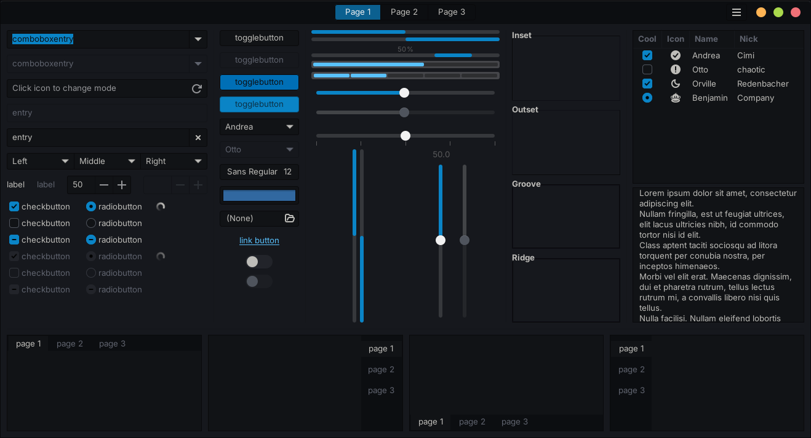
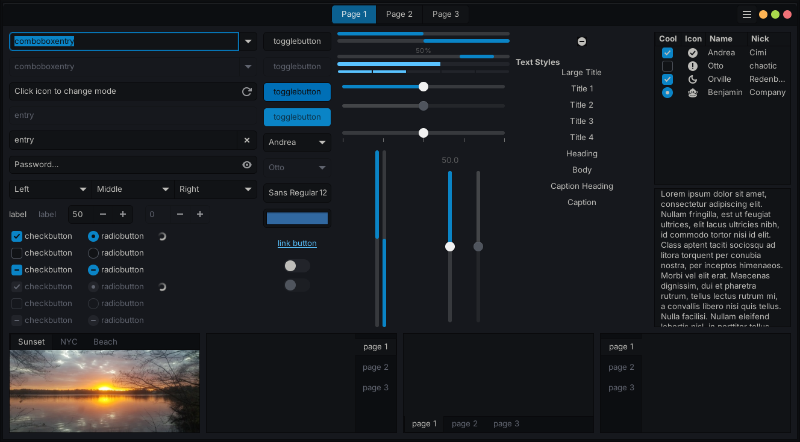
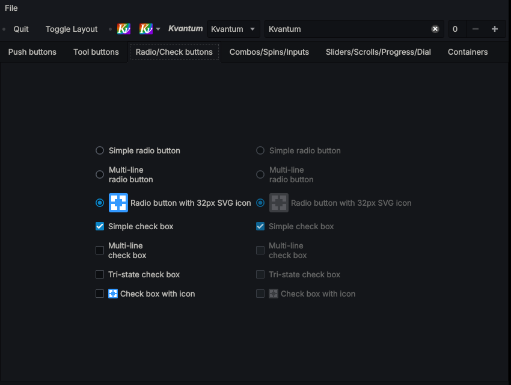

# Sumi

A dark GTK and Qt theme with near-black neutral greys and one deep-blue accent.
It has one variant and no dependencies beyond the toolkits themselves.





| Target | Notes |
|---|---|
| GTK 3 | Full theme |
| GTK 4 / libadwaita | Full theme, plus libadwaita's named colors |
| GTK 2 | Colors only, drawn by GTK's built-in engine |
| Qt 5 / Qt 6 | Kvantum theme |

## Install

Requires Python 3.11 or newer.

```sh
./build.py install    # → ~/.themes/Sumi and ~/.config/Kvantum/Sumi
```

**GTK.** Select the theme in your settings tool, or set it directly:

```sh
gsettings set org.gnome.desktop.interface gtk-theme Sumi
gsettings set org.gnome.desktop.interface color-scheme prefer-dark
```

Without a settings daemon (i3, sway and similar), put this in `~/.config/gtk-3.0/settings.ini`
and `~/.config/gtk-4.0/settings.ini`:

```ini
[Settings]
gtk-theme-name=Sumi
gtk-application-prefer-dark-theme=1
```

**libadwaita apps** ignore the GTK theme setting. Link the GTK 4 stylesheet into your user config:

```sh
mkdir -p ~/.config/gtk-4.0
ln -sf ~/.themes/Sumi/gtk-4.0/gtk.css ~/.config/gtk-4.0/gtk.css
ln -sfn ~/.themes/Sumi/assets ~/.config/assets
```

**Qt.** Choose *Sumi* in Kvantum Manager, or write `theme=Sumi` under `[General]` in
`~/.config/Kvantum/kvantum.kvconfig`. Then set the style to `kvantum` in qt5ct and qt6ct, with
`QT_QPA_PLATFORMTHEME=qt5ct` in your environment.

**Flatpak:**

```sh
flatpak override --user --filesystem=~/.themes:ro --env=GTK_THEME=Sumi
```

## Layout

```
palette.toml        every color in the theme, by role
build.py            renders src/ with the palette into dist/
src/
  index.theme
  assets/           check, dash and bullet marks (shape only; color comes from CSS)
  gtk-2.0/gtkrc
  gtk-3.0/gtk.css
  gtk-4.0/gtk.css
  kvantum/          Sumi.kvconfig, Sumi.svg
```

`dist/` is generated and not committed.

## Changing the theme

Every text file in `src/` is a template. Wherever a color is needed, it names a palette role:

```css
button:hover { background-color: $bg_raised; }
entry.error  { border-color: $error/0.4; }     /* 40% opacity */
```

To change a color everywhere, edit `palette.toml` and run `./build.py`. To change how a
widget looks, edit its section in `src/gtk-3.0/gtk.css` or `src/gtk-4.0/gtk.css` (each
section starts with a `/* ── Name ── */` banner), then rebuild.

The build stops with an error if a template uses a name that is not in the palette, or writes a
hex color directly. If a new color is needed, give it a role in the palette first. The build
also reports palette entries that nothing uses.

Opacity tokens become `rgba()` in CSS and `#rrggbbaa` in Kvantum files. Kvantum's SVG takes
plain colors only, because Qt's SVG renderer doesn't support `rgba()`.

To check a change quickly, run the GTK widget factories against the built theme:

```sh
./build.py install && GTK_THEME=Sumi gtk3-widget-factory
```

## Style guide

These rules decide how new or changed widgets should look.

- **One dark variant.** There is no light theme and no alternative accents. Everything is
  designed for a dark desktop.
- **Quiet surfaces.** Backgrounds are near-black greys with only a faint blue tint. Depth comes
  from small steps on one neutral ramp (darkest: header bars and sidebars; then views; then
  windows; then raised elements), not from shadows or gradients.
- **One accent.** The deep blue marks focus, selection, checked controls and progress, and
  nothing else. Its lighter tint is the accent used as text (links, info). The accent is never
  used for decoration.
- **Color carries meaning.** Apart from the accent, color appears only for state: error,
  warning and success. Each has one color, used the same way everywhere. Violet and brown are
  never used.
- **Fills stay readable.** Selected rows and check marks put the darkest surface color on the
  accent. Filled buttons keep light text. When a state color tints a large area, it is mixed in
  faintly, not painted solid.
- **States step, they don't jump.** Hover raises a surface one step. Pressed or checked uses
  the accent. Disabled drops contrast. Unfocused (backdrop) windows mute text but keep their
  layout.
- **Thin and modest.** Borders are 1px. Corners are slightly rounded. Controls are drawn with
  CSS rather than images, so they follow the palette automatically.
- **No compositor assumed.** Nothing depends on translucency or blur, so the theme looks the
  same with or without a compositor.
- **Minimal emphasis.** Bold is kept for titles and the selected row.

## Credits and license

Sumi started as a recolor of [Nordic](https://github.com/EliverLara/Nordic) by Eliver Lara and
keeps much of its widget CSS. It is released under the same license, GPL-3.0; see `LICENSE`.
